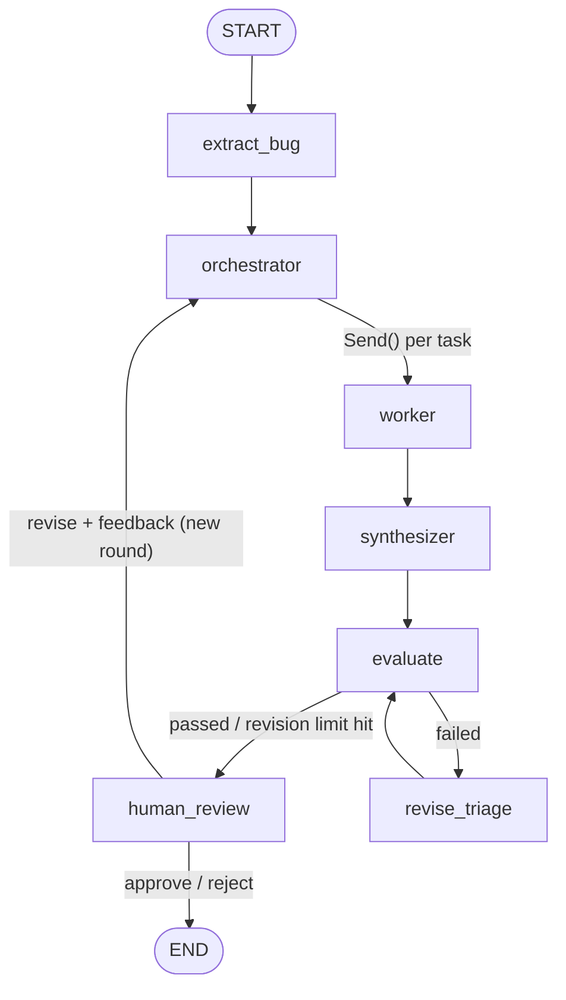

# Bug Triage Project

An LLM-powered bug triage pipeline built with **LangGraph**, served over **FastAPI**, with a **React** web UI.

Paste in a raw, unstructured bug report and the pipeline will:

1. **Extract** it into a structured `BugReport` (title, service, environment, logs, repro steps, recent changes, ...).
2. **Plan** an investigation: an orchestrator decides which investigations are needed (`severity`, `component`, `duplicate`, `root_cause`).
3. **Investigate in parallel**: one worker per task, each returning a conclusion, evidence, confidence, and limitations.
4. **Synthesize** the worker findings into a final `TriageResult` (severity, affected components, probable causes, recommended team and actions, confidence, uncertainty).
5. **Evaluate** the triage for groundedness, completeness, consistency, severity policy, and actionability. If it fails, it is **revised** automatically and re-evaluated (up to 5 revisions per round).
6. **Pause for human review**: a person approves, rejects, or asks for a revision with feedback.
7. **Re-investigate on revision**: the reviewer's feedback goes back to the orchestrator, which re-plans; the workers re-investigate with that feedback; and the new triage is evaluated, including a check that the feedback was applied, before it returns for review. Feedback from every round is kept, and the latest round wins if two rounds conflict.

Every LLM step uses structured output (Pydantic models), and the prompts tell the model to stay grounded in the supplied evidence and not invent logs, causes, or duplicate tickets.

Triages are **saved to SQLite**, so they survive server restarts, and identical LLM prompts are **served from a cache** instead of calling OpenAI again.

## Pipeline



`human_review` uses LangGraph's `interrupt()`. The graph is checkpointed per `thread_id` in a SQLite database, so the run pauses there and is resumed later by the `/bug-review` endpoint, even after a server restart.

A **review round** begins each time the reviewer asks for a revision. A new round re-runs planning and investigation and replaces the previous round's worker findings. It also resets the automatic revision counter, so every round gets its own budget of up to 5 evaluator-driven revisions.

## Requirements

- [uv](https://docs.astral.sh/uv/)
- Python 3.12 (uv will use the version in `.python-version`)
- [Node.js](https://nodejs.org) (includes npm), to build the React frontend
- An OpenAI API key

## Setup

```bash
uv sync
```

Create a `.env` file in the project root (see `.env.example`):

```env
OPENAI_API_KEY=sk-your-key-here
# Optional, defaults to gpt-4o-mini
# OPENAI_MODEL=gpt-4o-mini
```

`.env` is git-ignored. Never commit your key.

## Running the app

```bash
uv run bug-triage-project
```

This single command:

1. Builds the React frontend if it hasn't been built yet or its source has changed. The first run also runs `npm install`, which takes a minute.
2. Starts the server on <http://127.0.0.1:8000>, which serves both the web UI and the API.
3. Opens the app in your browser. Pass `--no-browser` to skip this.

Set the `HOST` / `PORT` environment variables to change the address. Press `Ctrl+C` to stop.

### Using the web UI

1. Paste a bug report, or click one of the sample reports, then click **Run triage**. A triage takes about 10–30 seconds.
2. Read the result: severity, confidence, recommended team and actions, probable causes, evidence, and uncertainty. The **Automatic evaluation** panel shows how the evaluator scored it, and **Extracted bug report** shows what was pulled out of your text.
3. In **Your review**, either:
   - write what should change and click **Request revision**. The agents re-plan and re-investigate with your feedback, and the new triage comes back for review as the next **round**. Repeat as often as you need.
   - or click **Approve** or **Reject** to finish.

The open triage's ID is kept in the page address (`?thread=...`), so refreshing the page, or bookmarking it and coming back later, reopens the same triage.

API docs (Swagger UI) are at <http://127.0.0.1:8000/docs>.

### Frontend development

To work on the UI with hot reload, run the API and the Vite dev server side by side:

```bash
uv run uvicorn api.main:app --reload
```

```bash
npm run dev --prefix frontend
```

Then open <http://localhost:5173>. Vite forwards API calls to the server on port 8000.

## Using the API

### 1. Submit a bug report: `POST /bug-triage`

```bash
curl -X POST http://127.0.0.1:8000/bug-triage \
  -H "Content-Type: application/json" \
  -d '{"bug_report": "Checkout returns HTTP 500 in production since the v2.14 deploy. ~30% of orders fail. Logs: NullPointerException at PaymentGatewayClient.charge(PaymentGatewayClient.java:88). v2.14 refactored PaymentGatewayClient to read a new config key payments.gateway.timeout."}'
```

PowerShell:

```powershell
$body = @{ bug_report = "Checkout returns HTTP 500 in production since the v2.14 deploy..." } | ConvertTo-Json
Invoke-RestMethod -Method Post -Uri http://127.0.0.1:8000/bug-triage -ContentType "application/json" -Body $body
```

Response (abridged):

```json
{
  "thread_id": "0cc384b4-4d1e-4075-ac4c-0b4ff4cd2a4a",
  "status": "awaiting_review",
  "bug_report": { "title": "Checkout fails with 500 after deploying v2.14", "service": "payments-service", "...": "..." },
  "triage_result": {
    "severity": "High",
    "affected_component": ["PaymentGatewayClient"],
    "probable_causes": ["NullPointerException in PaymentGatewayClient.charge after the timeout config refactor..."],
    "duplicate_candidates": [],
    "recommended_team": "payments-service",
    "recommended_actions": ["Investigate the initialization of the new gateway timeout config key..."],
    "confidence": 0.8,
    "evidence_summary": ["..."],
    "uncertainty": "..."
  },
  "evaluation": { "passed": true, "overall_score": 0.9, "...": "..." },
  "revision_count": 0,
  "review_round": 1,
  "human_decision": null,
  "review_history": []
}
```

Keep the `thread_id`. You need it for the review step. All three endpoints return this same shape:

- `revision_count`: automatic revisions in the current round.
- `review_round`: starts at 1 and goes up with every human revision.
- `review_history`: every human decision so far, with its feedback.

`GET /bug-triage/{thread_id}` returns the current state of a saved triage.

### 2. Review the triage: `POST /bug-review`

```bash
curl -X POST http://127.0.0.1:8000/bug-review \
  -H "Content-Type: application/json" \
  -d '{"thread_id": "<thread_id>", "decision": "revise", "feedback": "Checkout is revenue-critical, reconsider severity and add a rollback action."}'
```

| `decision` | What happens | Returned `status` |
|---|---|---|
| `approve` | Triage is accepted and the run ends. | `completed` |
| `reject`  | Triage is rejected and the run ends. | `rejected` |
| `revise`  | Starts a new round. Your `feedback` (required) goes back to the orchestrator, the workers re-investigate, the result is re-evaluated, and the run pauses for review again. | `awaiting_review` |

Errors:

- `404`: unknown `thread_id`
- `409`: the thread is not waiting for review (already approved or rejected)
- `422`: invalid request (for example an empty bug report, an unknown decision, or `revise` without feedback)

## Running the tests

```bash
uv run pytest
```

The tests never call OpenAI and never touch your data files. Every LLM call is mocked, and `Test/conftest.py` sets a dummy API key, keeps checkpoints in memory, and turns the LLM cache off.

- `Test/test_api.py` runs the real compiled graph through the FastAPI endpoints with a fake LLM. It covers approve, reject, and revise, including checks that revise feedback reaches the planner, every worker, and the evaluator, and that feedback from earlier rounds is kept. It also covers automatic revision and the error responses.
- `Test/test_persistence.py` checks that a paused triage survives a restart.
- `Test/test_llm_cache.py` checks that repeated prompts are served from the cache.
- `Test/test_frontend.py` checks that the UI is served without hiding the API routes, and that the rebuild check notices source changes.

## Project structure

```
api/
  main.py             FastAPI app: /bug-triage (POST, GET) and /bug-review endpoints
  frontend.py         Serves the built React app at "/"
  schema/triage.py    Request/response models
frontend/             React + Vite web UI
  src/App.jsx         Page state: triage → review flow
  src/api.js          Calls to /bug-triage and /bug-review
  src/components/     Form, loading state, triage result, evaluation, review panel
data/                 checkpoints.sqlite (saved triages) and llm_cache.sqlite (git-ignored)
graph/
  graph.py            LangGraph StateGraph wiring + SQLite checkpointer
Models/
  bug_model.py        Pydantic models (BugReport, InvestigationPlan, WorkerResult, TriageResult, EvaluationResult, HumanDecision)
  state.py            Graph state (BugTriageState, WorkerState)
  Nodes.py            Node implementations + LLM client
  llm_cache.py        SQLite cache of structured LLM responses
prompts/
  prompts.py          System prompts for each LLM step
src/bug_triage_project/
  __init__.py         `bug-triage-project` console script (builds the UI, starts the server)
  frontend.py         Decides when the frontend needs rebuilding and runs the build
Test/                 pytest suite
```

## Configuration

| Variable | Default | Purpose |
|---|---|---|
| `OPENAI_API_KEY` | (required) | OpenAI API key |
| `OPENAI_MODEL` | `gpt-4o-mini` | Chat model used by every node |
| `HOST` | `127.0.0.1` | Bind address for `bug-triage-project` |
| `PORT` | `8000` | Port for `bug-triage-project` |
| `CHECKPOINT_DB` | `data/checkpoints.sqlite` | Where triages are saved |
| `LLM_CACHE_DB` | `data/llm_cache.sqlite` | Where OpenAI responses are cached. Set to `off` to always call OpenAI. |

The automatic revision limit is `MAX_REVISIONS = 5` (per round) in `Models/Nodes.py`.

### The LLM cache

Every LLM call is cached by a hash of the model name, the output schema, and the exact prompt. Re-running an identical bug report therefore returns instantly at no cost: in testing, a repeat triage took 0.5s instead of 13s. A revision always includes new feedback, so it is never served from the cache.

The cache never expires. If you change a prompt in `prompts/prompts.py`, the new prompt has a different hash, so old entries are simply not used. To clear the cache, stop the server and delete `data/llm_cache.sqlite`. The same goes for saved triages and `data/checkpoints.sqlite`.

## Limitations

- **No list of past triages.** Saved triages are reopened by their link (`?thread=...`); the UI doesn't have a list of past triages yet.
- **Single server process.** SQLite suits one server process. For multiple processes or machines, switch to a Postgres checkpointer (`langgraph-checkpoint-postgres`) in `graph/graph.py`.
- **No issue database for duplicate detection.** The duplicate worker only sees the submitted report, so `duplicate_candidates` will usually be empty unless the report itself references existing tickets.
- **No authentication** on the API endpoints.
